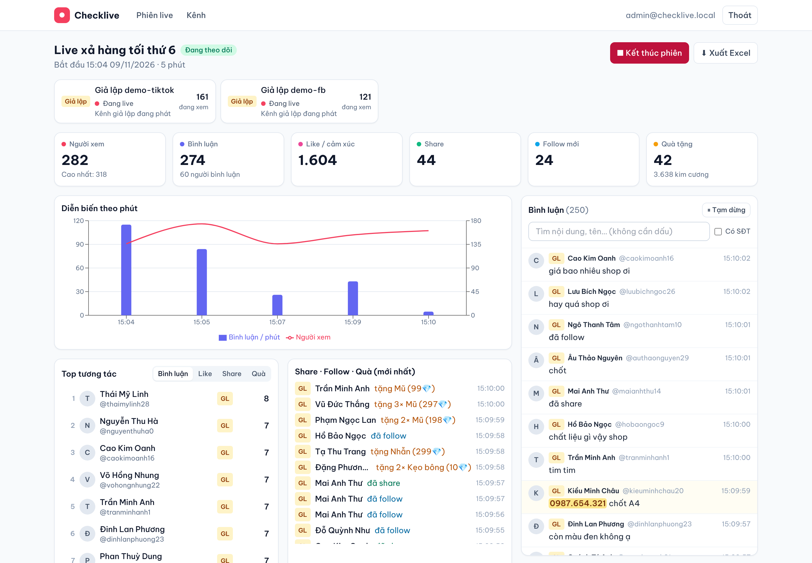
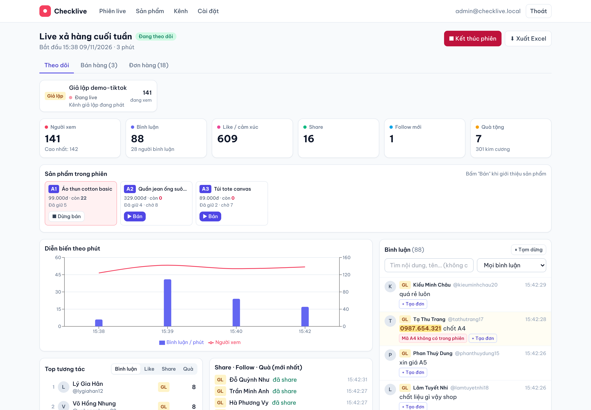
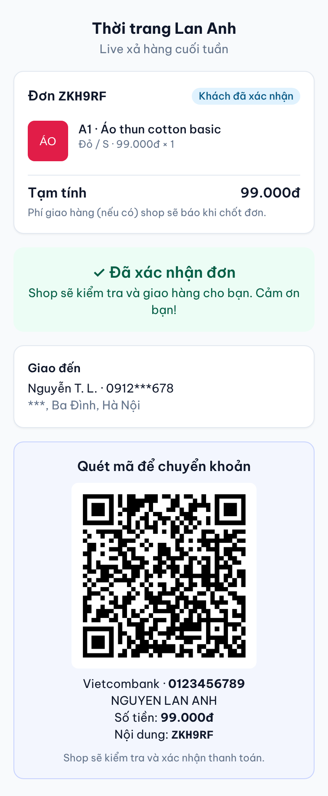
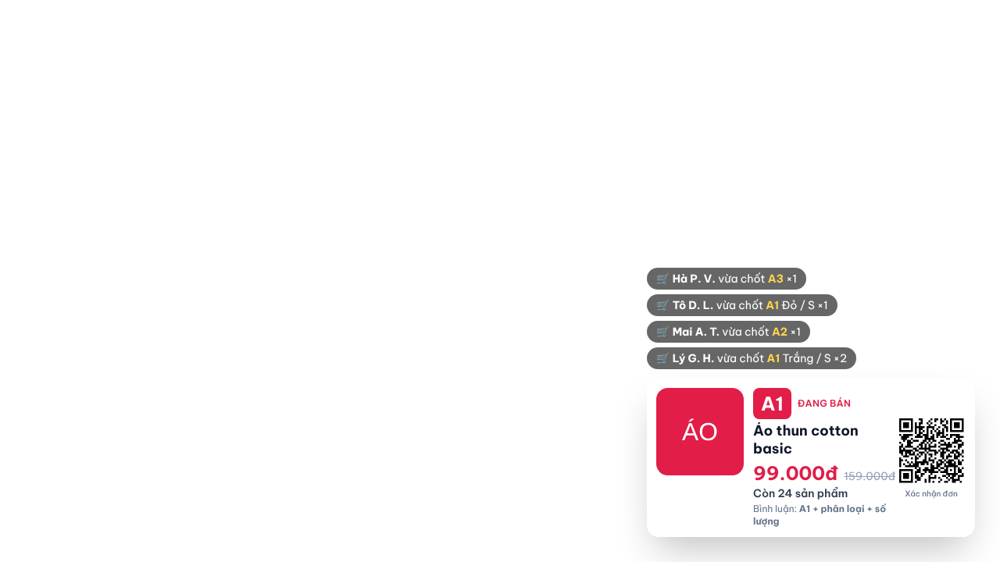
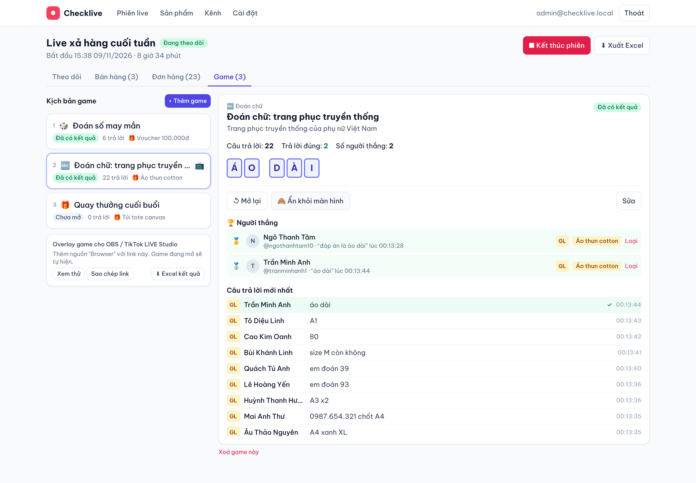
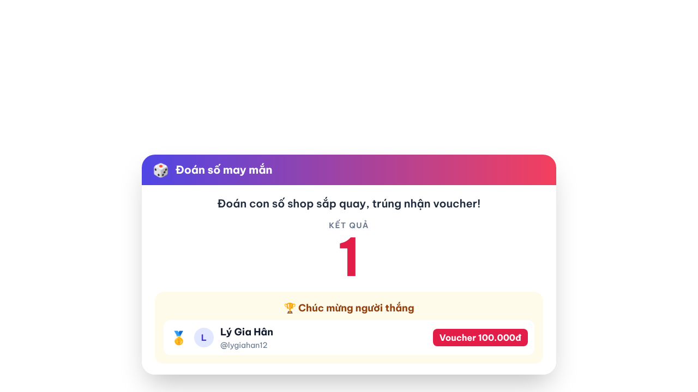
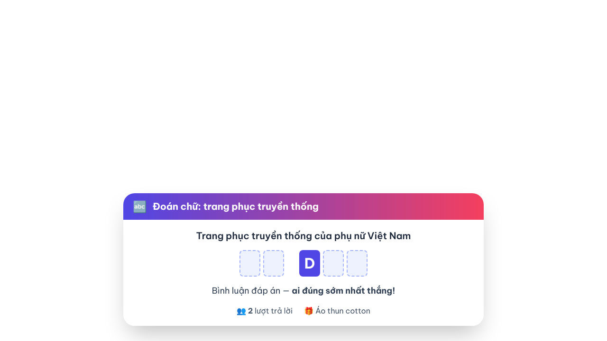
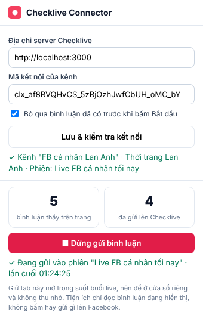

# Checklive

Webapp theo dõi phiên live Facebook & TikTok: gom bình luận, thống kê tương tác, chạy game show và chốt đơn bằng mã sản phẩm.

- Kế hoạch sản phẩm và các quyết định đã chốt: [docs/KE-HOACH.md](docs/KE-HOACH.md)



## Đã làm được (Giai đoạn 0 + 1: Thống kê)

- Đăng nhập quản trị.
- Quản lý kênh: **TikTok** (@username hoặc link, theo dõi được cả kênh người khác), **Fanpage Facebook** (Page ID + Page access token), **kênh giả lập** để thử khi chưa có live thật.
- Phiên live gộp nhiều kênh (FB + TikTok cùng lúc). Mỗi kênh chỉ chạy trong 1 phiên tại một thời điểm.
- Tự chờ kênh lên sóng, tự kết nối lại khi rớt mạng, tự phát hiện live kết thúc.
- Bảng điều khiển realtime:
  - Người xem hiện tại / cao nhất, bình luận, số người bình luận, like, share, follow, quà (kim cương).
  - Biểu đồ bình luận và người xem theo phút.
  - Top người tương tác (bình luận / like / share / quà).
  - Luồng bình luận gộp các nền tảng: tìm kiếm không dấu, lọc theo nền tảng, lọc bình luận **có số điện thoại** (tô sáng), tạm dừng cuộn.
  - Danh sách share / follow / quà mới nhất.
- Lưu toàn bộ vào PostgreSQL; xem lại phiên cũ; **xuất Excel** (Tổng quan, Bình luận, Người tham gia, Theo phút).
- Giao diện dùng tốt trên điện thoại.

## Đã làm được (Giai đoạn 2: Bán hàng)



- **Kho sản phẩm**: tên, giá, ảnh, phân loại tự do (màu, size, vị… tối đa 3 thuộc tính), tồn kho và giá riêng theo từng phân loại.
- **Sản phẩm trong phiên**: gắn sản phẩm từ kho với **mã live tự đặt** (A1, A2… hoặc mã riêng), giá live, số lượng mở bán trong phiên, giới hạn mỗi khách. Bấm **Bán / Dừng bán** khi giới thiệu từng sản phẩm.
- **Tự tạo đơn từ bình luận**, hiểu các dạng:
  - `A1`, `A1 2`, `A1 x2`, `2 cái A1`
  - `A1 đỏ M`, `a1 do m 2` (không cần dấu)
  - nhiều sản phẩm: `A1 đỏ M, A2 L`, `A1 + A3`
  - `chốt`, `+1`, `chốt đỏ M` → sản phẩm đang bán (từ khoá chốt tự cài)
  - Câu hỏi ("A1 còn không?") và mã không có trong phiên **không** tạo đơn; bình luận có SĐT thì SĐT được điền sẵn vào đơn.
- **Giữ hàng chính xác**: ai bình luận trước được giữ trước, không bán quá tồn kho kể cả khi nhiều người chốt cùng lúc. Hết hàng thì vào **danh sách chờ**; có hàng lại (huỷ đơn, hết hạn, tăng tồn kho) thì người chờ đầu tiên tự được giữ hàng.
- **Thời gian giữ hàng tuỳ chọn** theo phiên (30 phút → 7 ngày hoặc không giới hạn); quá hạn chưa xác nhận thì đơn tự huỷ.
- Nhiều bình luận của cùng khách được **gộp vào 1 đơn**. Mỗi bình luận hiện kết quả ngay trong luồng bình luận (đã tạo đơn / hết hàng / câu hỏi / mã sai) và có nút **"Tạo đơn"** thủ công.
- **Khách tự xác nhận** bằng QR / link: chọn phân loại còn thiếu, nhập địa chỉ (khách cũ dùng lại thông tin đã lưu), chọn COD hoặc **chuyển khoản VietQR** (đúng số tiền, nội dung là mã đơn).
- **Nhân viên quản lý đơn**: lọc theo trạng thái, sửa phân loại / số lượng, chốt đơn, đánh dấu đã thanh toán, đã giao (trừ tồn kho), huỷ, đánh dấu khách bom hàng; xuất Excel đơn hàng.
- **Overlay OBS / TikTok LIVE Studio**: sản phẩm đang bán, giá, số còn lại, mã QR xác nhận đơn, dòng "vừa chốt".

| Khách tự xác nhận + chuyển khoản | Overlay trên màn hình live |
|---|---|
|  |  |

### Cách dùng phần bán hàng

1. **Cài đặt** → nhập tên shop và tài khoản ngân hàng (bấm "Quét thử" bằng app ngân hàng để kiểm tra).
2. **Sản phẩm** → thêm sản phẩm, phân loại và tồn kho.
3. Tạo phiên live → tab **Bán hàng** → thêm sản phẩm vào phiên (mã A1, A2…), chọn thời gian giữ hàng.
4. Bấm **Bắt đầu theo dõi**. Trong lúc live, bấm **Bán** ở sản phẩm đang giới thiệu.
5. Đưa mã QR "Trang tra cứu & xác nhận đơn" lên màn hình live (hoặc dùng overlay) để khách tự xác nhận.
6. Tab **Đơn hàng** → xử lý đơn "Cần xử lý", chốt đơn, xuất Excel.

> Lưu ý với TikTok: không gửi tin nhắn riêng cho khách được, nên khách tra cứu đơn bằng @username. Người khác biết username cũng có thể mở đơn đó (thông tin cá nhân luôn được che), vì vậy nhân viên vẫn cần bấm **Chốt đơn** sau khi kiểm tra.

## Đã làm được (Giai đoạn 3: Game show)



- **Kịch bản game**: soạn sẵn các game trước buổi live, khi live chỉ cần bấm **Mở**.
- **4 loại game**:
  - 🎲 **Đoán số**: khách bình luận 1 con số trong khoảng (VD 1–100). Shop bấm **Quay số** (ngẫu nhiên) hoặc nhập số tự quay. **Ai đoán trúng sớm nhất thắng**.
  - 🔤 **Đoán chữ**: ô chữ hiện trên màn hình, shop mở dần từng chữ (bấm vào ô hoặc mở ngẫu nhiên). **Ai bình luận đúng cả từ sớm nhất thắng**.
  - ❓ **Đố vui**: câu hỏi + nhiều cách ghi đáp án được chấp nhận.
  - 🎁 **Quay thưởng**: bốc thăm ngẫu nhiên trong số người bình luận từ khoá (VD "tham gia").
- **Luật công bằng**:
  - Mỗi người chỉ tính câu trả lời đầu tiên.
  - Bình luận rõ ràng không phải câu trả lời (hỏi hàng, mã sản phẩm, số điện thoại…) **không bị tính mất lượt**.
  - Không phân biệt dấu ("ao dai" = "Áo dài"), chấp nhận "đáp án là áo dài".
  - Xếp hạng theo **thời điểm bình luận**, không theo thời điểm hệ thống nhận được. Bình luận gửi trước lúc khoá nhưng đến trễ vài giây (hay gặp với Facebook) vẫn được tính.
  - Bình luận gửi trước khi mở game không được tính.
- **Tự khoá** sau N giây (đếm ngược trên màn hình) hoặc khi đã đủ số người trả lời đúng.
- **Phần thưởng tự đặt** theo thứ hạng (Giải nhất, Giải nhì…).
- **Điều kiện nhận giải**: đã thả tim / share / follow. Chỉ kiểm tra được với TikTok, và chỉ tính thao tác trong buổi live. Với người chơi Facebook, shop chọn bỏ qua điều kiện hoặc không tính.
- **Loại người thắng** không hợp lệ thì người kế tiếp tự lên thay.
- **Overlay game** cho OBS / TikTok LIVE Studio: hiệu ứng quay số (không lộ kết quả trước giờ công bố), ô chữ, đồng hồ đếm ngược, người thắng và phần thưởng.
- **Xuất Excel**: người thắng và toàn bộ câu trả lời kèm thời điểm, dùng để đối chiếu khi có khiếu nại.

| Overlay đoán số | Overlay đoán chữ |
|---|---|
|  |  |

## Đã làm được (Giai đoạn 3b: Tiện ích Chrome cho Facebook)

Dùng cho live Facebook mà API chính thức không đọc được: **trang cá nhân, Group, Fanpage của người khác**.



- Tiện ích **Checklive Connector** (Chrome / Cốc Cốc / Edge…) đọc bình luận đang hiển thị trên trang live Facebook bạn mở, rồi gửi về Checklive.
- Bình luận đi vào cùng luồng xử lý như TikTok, nên **thống kê, chốt đơn và game đều dùng được**.
- Mỗi kênh có **mã kết nối** riêng: chỉ gửi được vào đúng kênh đó; đổi mã thì mã cũ hết hiệu lực ngay.
- Bỏ qua bình luận đã có trước khi bấm Bắt đầu. Facebook vẽ lại bình luận cũ khi cuộn thì cũng không bị gửi trùng (dùng `comment_id` của Facebook).
- Mạng chập chờn thì tự gửi lại. Trang tải lại khi đang bật thì tự bật lại.
- Popup hiện **số bình luận thấy trên trang**, giúp biết ngay tiện ích có đọc được trang hay không.
- Chỉ **đọc**, không bấm và không đăng gì lên Facebook.

**Cài đặt:** Kênh → Facebook → "Qua tiện ích Chrome" → thêm kênh → làm theo hướng dẫn hiện dưới kênh (tải `.zip` đã điền sẵn địa chỉ server, `chrome://extensions` → Chế độ nhà phát triển → Tải tiện ích đã giải nén → dán mã kết nối).

**Giới hạn:**
- Không biết ai like / share. Thời điểm bình luận là lúc tiện ích nhìn thấy (trễ khoảng 1 giây), không phải giờ Facebook ghi nhận.
- Phải giữ tab live mở trên máy tính suốt buổi, nên để ở cửa sổ riêng, không thu nhỏ.
- Facebook đổi giao diện có thể làm tiện ích ngừng đọc được. Khi đó chỉ cần sửa `extension/fb-extract.js`.

<br clear="right">

## Chạy bằng Docker (khuyên dùng khi đưa lên VPS)

```bash
cp .env.example .env      # sửa JWT_SECRET và ADMIN_PASSWORD
docker compose up -d --build
```

Mở `http://<địa-chỉ-máy>:3000`, đăng nhập bằng `ADMIN_EMAIL` / `ADMIN_PASSWORD` trong `.env`.

## Chạy để phát triển

Cần Node.js 22+ và PostgreSQL 16.

```bash
npm install
cp server/.env.example server/.env        # sửa DATABASE_URL, JWT_SECRET…
npm run db:migrate -w server               # tạo bảng
npm run dev:server                         # API + realtime: http://localhost:3000
npm run dev:web                            # giao diện: http://localhost:5173
```

Kiểm thử:

```bash
npm test                                                     # unit test
TEST_DATABASE_URL=postgresql://.../checklive_test npm test   # thêm test tích hợp (cần CSDL test đã migrate)
```

## Kết nối Facebook (Fanpage)

Facebook chỉ cho đọc live của **Fanpage bạn quản trị** qua API chính thức. Cách lấy Page access token khi đang dùng cho shop của bạn (chưa cần Meta duyệt app):

1. Vào [developers.facebook.com](https://developers.facebook.com) → **Tạo ứng dụng** (loại Business).
2. Mở **Graph API Explorer**, chọn ứng dụng vừa tạo, thêm các quyền: `pages_show_list`, `pages_read_engagement`, `pages_read_user_content`. Bấm **Generate Access Token** và cho phép truy cập Fanpage.
3. Đổi sang token dài hạn: mở **Access Token Debugger**, dán token, bấm **Extend Access Token**.
4. Quay lại Graph API Explorer với token dài hạn, gọi `GET /me/accounts`. Lấy `id` (Page ID) và `access_token` (Page access token) của Fanpage.
5. Trong Checklive → **Kênh** → **Fanpage**: dán Page ID và Page access token → **Kiểm tra**.

Ghi chú:

- Danh sách quyền Meta yêu cầu có thể thay đổi. Nếu bấm **Kiểm tra** báo thiếu quyền, thêm quyền được nêu trong thông báo lỗi rồi lấy lại token.
- Facebook chỉ cung cấp **tổng số** cảm xúc. Không biết ai đã like, không có số share và follow theo từng người.
- Bước sau (bán tool cho shop khác) sẽ thay việc dán token bằng nút "Đăng nhập bằng Facebook", và cần Meta duyệt app.

## Kết nối TikTok

- Chỉ cần @username, không cần đăng nhập. Dùng thư viện **không chính thức** [`tiktok-live-connector`](https://www.npmjs.com/package/tiktok-live-connector), nên có thể gián đoạn khi TikTok thay đổi.
- Nên đăng ký API key miễn phí tại [Euler Stream](https://www.eulerstream.com) và điền vào `EULER_API_KEY` để kết nối ổn định hơn.
- TikTok cung cấp chi tiết theo từng người: bình luận, like, share, follow, quà, người vào phòng.

## Cấu trúc

```
server/   API (Fastify) + Socket.IO + bộ kết nối nền tảng + thống kê + Prisma/PostgreSQL
  src/adapters/   tiktok.ts, facebook.ts, simulator.ts — mỗi nền tảng 1 bộ chuyển đổi về định dạng sự kiện chung
  src/live/       sessionManager.ts (chạy phiên), stats.ts (tổng hợp), persistence.ts, exportXlsx.ts
  src/sales/      parser.ts (đọc cú pháp chốt đơn), orderService.ts (giữ hàng, danh sách chờ, xác nhận), vietqr.ts
  src/games/      matcher.ts (so khớp đáp án, ô chữ), gameService.ts (nhận câu trả lời, quay số, chọn người thắng)
web/      Giao diện React + Vite + Tailwind
extension/  Tiện ích Chrome: fb-extract.js (đọc bình luận Facebook), content.js, background.js, popup
            Kiểm tra bộ đọc: node extension/test/extract.test.cjs (cần Playwright)
docs/     Kế hoạch sản phẩm
```
